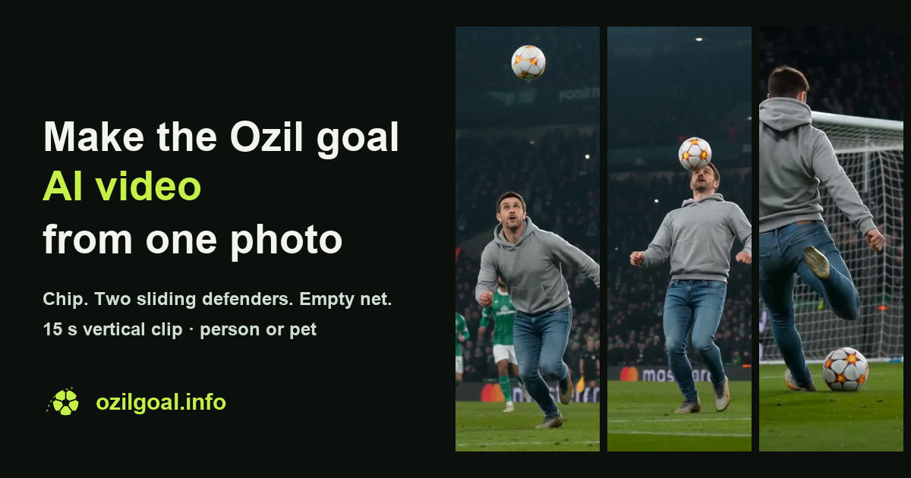

# Ozil Goal AI Video: how to make the viral clip from one photo

The "Ozil goal" trend recreates one famous move: a chip over the keeper, a touch to control it, two defenders sliding past, and a calm finish into the empty net. People put themselves, their friends or their pets into the scene and post it as a 9:16 short.

This page explains how to make that clip with [OzilGoal](https://ozilgoal.info/?utm_source=github&utm_medium=readme&utm_campaign=ozil_trend), a browser tool I built for it.

> OzilGoal is an independent fan-made tool. It is not affiliated with or endorsed by Mesut Özil, any club, TikTok or ByteDance. It generates a fictional scene; it does not edit real match footage.

## Steps

1. Open the [Ozil goal generator](https://ozilgoal.info/?utm_source=github&utm_medium=readme&utm_campaign=ozil_trend).
2. Upload one clear photo of a person or a pet. One subject, face or body visible, good light.
3. Pick a style and kit, then a model and resolution (480p or 720p; 1080p on the top model).
4. Generate. The result is a 15-second vertical video with the trend soundtrack added in your browser.
5. Download the MP4 and post it.

A longer walkthrough with photo tips is on the [how-to guide](https://ozilgoal.info/how-to-make-ozil-ai-goal-video?utm_source=github&utm_medium=readme&utm_campaign=ozil_trend).

## Photo tips

- Use a single subject. Group photos confuse which player should take the shot.
- Avoid heavy filters, sunglasses and hats that hide the face.
- Pets work best from a side or three-quarter angle with the whole body in frame.
- Portrait or square photos are fine; the output is always 9:16.

## Other scenes

- [Lamine Yamal rabona AI video](https://ozilgoal.info/lamine-yamal-rabona-ai?utm_source=github&utm_medium=readme&utm_campaign=ozil_trend): the outside-of-the-foot rabona finish.
- [What the Ozil goal meme is](https://ozilgoal.info/ozil-goal-meme?utm_source=github&utm_medium=readme&utm_campaign=ozil_trend): where the trend came from.

## FAQ

**Is it free?** Generation uses credits. Current packs are on the [pricing page](https://ozilgoal.info/pricing?utm_source=github&utm_medium=readme&utm_campaign=ozil_trend).

**Does it use real match footage?** No. The scene is generated from your photo and a written description of the move.

**Can I use a pet photo?** Yes. Cats and dogs work too.
